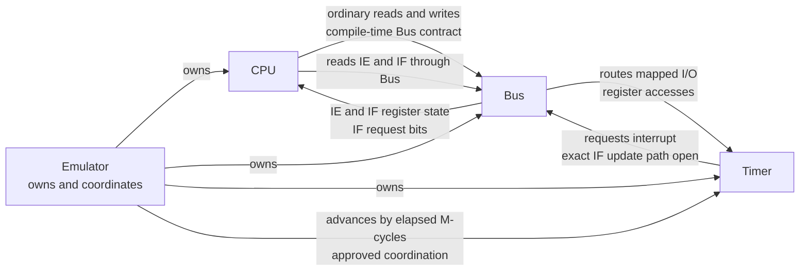
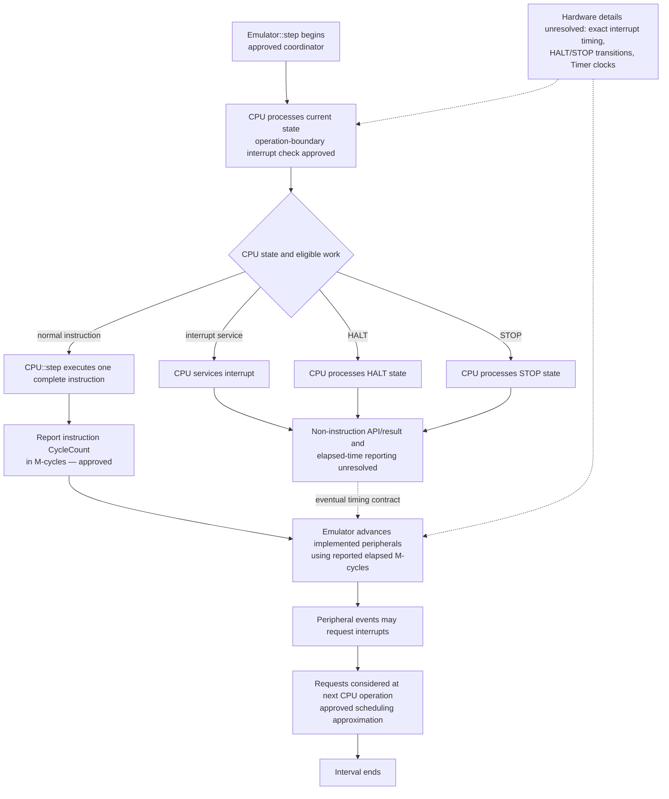
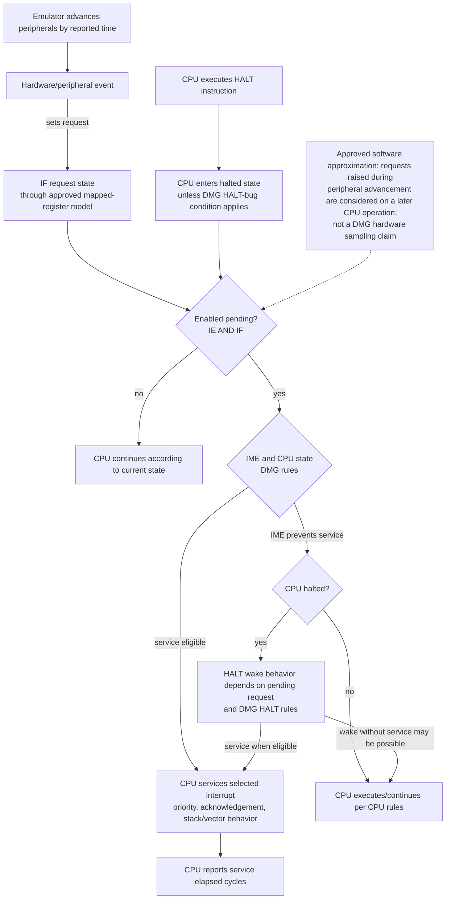

# Game Boy Emulator — High-Level Design

## 1. Scope, decision status, and constraints

This HLD targets original Game Boy / DMG behavior first and prioritizes readability, learning value, testability, and sound software architecture. It describes system responsibilities and execution coordination, not individual CPU instruction designs.

### Established constraints and approved decisions

- The `Emulator` owns the CPU, concrete `Bus`, and initial Timer; direct member ownership is preferred where practical (ADL-001, Approved).
- The CPU uses a small compile-time Bus contract; no runtime-polymorphic Bus interface is introduced (ADL-003, Approved).
- The concrete Bus incrementally implements the Game Boy memory map (ADL-004, Approved).
- IE (`0xFFFF`) and IF (`0xFF0F`) are memory-mapped and accessed by ordinary Bus operations. Interrupt request generation is separate from CPU servicing (ADL-005, Approved).
- CPU execution is initially instruction-stepped, returning a dedicated `CycleCount` measured in M-cycles; true CPU machine-cycle stepping is deferred (ADL-002, Approved).
- The Emulator coordinates peripheral advancement using elapsed cycles. CPU-specific behavior belongs to the CPU.

The software responsibility boundary and instruction-level coordination described here are approved in ADL-006. Exact DMG timing and state semantics remain unresolved and must be checked against reliable hardware documentation and tests. Recommendations marked open below are not approvals.

## 2. Component architecture

Diagram semantics: ownership, device-owned I/O routing, operation-boundary coordination, and M-cycle advancement are approved software architecture. The exact request-to-IF path and Timer clock behavior remain open hardware/interface details. The Timer need not call the full Bus; a narrow request interface or shared hardware-model state remain alternatives for review.

### Responsibilities

- **Emulator:** Composition root and system-level coordinator. It owns CPU, Bus, and Timer and coordinates CPU processing with advancement of implemented peripherals. It must not select instructions, decide interrupt priority, alter IME, or implement HALT/STOP rules.
- **CPU:** Owns registers and CPU state, instruction execution, interrupt eligibility/service semantics, and distinct HALT/STOP states and behavior. Normal `CPU::step()` executes one complete instruction and reports its elapsed `CycleCount` in M-cycles. The result/API for interrupt service and HALT/STOP processing remains open.
- **Bus:** Implements address-based reads/writes and maps memory regions and I/O. It presents IE/IF as ordinary mapped registers and routes mapped device-register accesses to device-owned state, avoiding duplicate ownership (ADL-006, Approved). The exact request path by which a peripheral sets IF remains open.
- **Timer:** Owns its timer-specific hardware state. The Emulator advances it. Timer events request an interrupt; the CPU later decides whether and when to service it. The minimal request-to-IF connection and Timer clock behavior remain open.
- **Other peripherals:** Own their respective hardware state; Emulator coordinates elapsed-time advancement in an explicit order based on verified dependencies (ADL-006, Approved). Exact timing behavior remains a hardware question.

## 3. CPU execution contract and one Emulator interval

### Approved coordination contract; operation outcome open

One `Emulator::step()` coordinates CPU processing followed by peripheral advancement. During normal execution, `CPU::step()` executes exactly one complete instruction and reports that instruction's elapsed `CycleCount` in M-cycles. It does not advance peripherals or expose intermediate machine cycles. CPU-owned interrupt servicing and HALT/STOP state processing remain CPU responsibilities; whether these are represented by the same public CPU operation or a distinct CPU outcome/API remains open. Such processing must not be described as a normal instruction.

The CPU may need to perform interrupt service, process HALT, or process STOP instead of ordinary instruction execution. These are distinct CPU-owned behaviors/states, not equivalent no-op instructions, and need not consume equal time. The precise CPU API for these non-instruction paths remains unresolved; do not imply they are ordinary instruction execution or choose an API here.

The approved software interval is CPU processing followed by Emulator-coordinated advancement of implemented peripherals when elapsed time is reported. For normal instruction execution, `CPU::step()` reports that instruction's `CycleCount` in M-cycles. Whether interrupt/HALT/STOP processing uses `CPU::step()` or a distinct CPU operation, and what result/time representation those paths use, remains open. The CPU decides CPU behavior; Emulator only coordinates.

**Timing caveat:** CPU-operation-boundary checks and subsequent-operation visibility of peripheral requests are approved software scheduling choices. They are not claims that DMG hardware samples requests only at those points. Exact interrupt-entry elapsed time, zero-cycle/wait representation, HALT/STOP progression, and Timer clock behavior remain unresolved and require hardware verification. This is not cycle-accurate modeling.

## 4. Interrupt checks and elapsed-cycle accounting

### Hardware behavior versus initial approximation

The CPU has interrupt enable state (IME), interrupt enable register IE, and interrupt requests in IF. Enabled pending requests are conventionally identified by `IE & IF`; interrupt service also depends on CPU state and DMG rules. The approved architecture assigns CPU servicing to the CPU and request generation to hardware/peripherals. Exact boundary timing, EI delay, priority, acknowledgement, HALT edge cases, and STOP behavior must follow DMG behavior; ADL-005 already records inclusion of priority, acknowledgement, IME, delayed EI, stack push, and vector jump.

Real hardware and detailed emulators can observe events at finer timing points than an instruction-level scheduler. With whole-instruction execution followed by peripheral advancement, a request generated by a peripheral update is not observed partway through that instruction. The implementation must describe this as an approximation, not claim the hardware only checks at that boundary.

### Approved scheduling boundary; DMG timing details open

The approved initial software policy is:

- CPU examines its own state and pending enabled requests at the start of a CPU processing operation.
- If interrupt service is eligible, CPU performs service according to CPU-owned semantics; otherwise normal execution uses `CPU::step()` for one complete instruction. How interrupt service and HALT/STOP processing expose elapsed time through a CPU API remains unresolved.
- Emulator advances peripherals using that operation's reported elapsed cycles.
- A request raised during peripheral advancement is visible to CPU processing on the next CPU operation, not retroactively during the operation just completed.

This is straightforward and testable but approximates event timing at CPU-operation boundaries. The precise DMG sampling/service rules, interrupt-entry timing, EI-delay interaction, and HALT entry/wake details still require verification. The CPU owns the decisions; this boundary does not prescribe unverified hardware semantics.

### Cycle accounting recommendations

| CPU operation | Recommended accounting model | Status / caveat |
|---|---|---|
| Normal instruction | `CPU::step()` executes one complete instruction and returns its elapsed M-cycles. | Instruction-level contract, per approved ADL-002. |
| Interrupt service | CPU owns service; do not treat it as a normal instruction. | Whether/how it reports elapsed time and relates to `CPU::step()` remains unresolved; DMG timing requires verification. |
| HALT processing | Report elapsed time for the chosen halted interval, or indicate that CPU is waiting if no simulated time advances. | Must not be treated as a zero-time no-op repeatedly; HALT clock/timer behavior and wake rules require verification. |
| STOP processing | Report/represent stopped progression according to DMG STOP behavior. | Do not assume Timer advances normally or that zero is appropriate; wake source, clocks, and elapsed time require verification. |
| No normal instruction progress | Report elapsed time according to the eventual CPU-state contract; do not infer that no instruction means zero cycles or that zero means waiting. | API and hardware policy open; decide only the minimum representation required by verified state behavior. |

A zero `CycleCount` means only zero elapsed time if such a value is permitted; it does not inherently mean waiting, stopped, or failure to progress. Repeatedly invoking a step operation that returns zero could busy-loop, but the architecture must not assign zero a meaning before the CPU-state contract and relevant DMG behavior are established. Alternatives include constraining supported operations to report elapsed time, adding a minimal status only if a legitimate no-time outcome exists, or letting the caller handle a distinct control path. **No result shape is selected here.** Avoid a generic outcome framework; define the smallest unambiguous contract after verifying which CPU operations can consume no simulated time.

The Emulator should advance implemented peripherals using elapsed time reported by CPU execution, subject to the selected hardware-state policy. For the initial implementation, `CycleCount` remains an explicit M-cycle type and normal `CPU::step()` executes one complete instruction and reports that instruction's elapsed M-cycles. Peripheral timing remains separate from instruction execution.

### Variable instruction timing and CPU tests

`CycleCount` must represent the elapsed time of the instruction actually executed, not a fixed per-call amount. Conditional instructions can have different elapsed M-cycles depending on whether the condition is taken; CB-prefixed instructions may likewise have instruction-specific timing. This is a contract for accurate accounting at the chosen instruction-level granularity, not a request to design individual instructions here.

The existing fake Bus from the approved compile-time Bus contract provides the seam for isolated CPU tests: instruction effects and flags can be checked against fake memory, memory reads/writes can be observed, and returned `CycleCount` values can be asserted. Interrupt tests can control IE/IF through that Bus contract. Tests should be added with the behaviors they cover; no additional testing abstraction is proposed.

### Timing-unit boundary and future migration

One normal-speed DMG M-cycle corresponds to four T-cycles, but that conversion must not be repeated as assumptions throughout CPU/peripheral code. Keep the timing unit explicit in `CycleCount` and centralize any M-cycle-to-T-cycle conversion or unit translation in one timing boundary/helper. Do not return unexplained integer counts or embed conversion arithmetic at each peripheral call site.

If greater timing resolution is later needed, the project may introduce a T-cycle-based elapsed-time representation at the CPU/peripheral coordination boundary while retaining instruction-level CPU execution: the CPU could still execute a whole instruction per call and report its total elapsed time in the new unit. That migration should not require redesigning component ownership or CPU responsibilities, but would change the timing value contract and peripheral advancement APIs. A T-cycle unit alone does not make execution cycle-accurate: sub-instruction CPU/peripheral ordering remains unavailable until CPU execution itself is interleaved at finer granularity. True CPU machine-cycle stepping is not part of the initial design.

The Timer owns its timer state and is advanced by the Emulator. Its initial implementation can use the approved instruction-level elapsed-time coordination, while keeping the Timer's internal time/edge calculation encapsulated so its clock-edge behavior can later be refined against DMG references and tests. This is a future-compatible boundary, not a commitment to a specific divider, edge-detection algorithm, or clock behavior in HALT/STOP.

## 5. Interrupt and HALT interaction

Diagram distinction: the mapped IE/IF path and separation between request generation and servicing are approved architectural decisions. `IE & IF`, IME, HALT, and interrupt service are hardware concepts; the precise transition/check sequence shown is intentionally not finalized. The HALT bug is a CPU behavior that must be represented where DMG conditions require it; it is not a separate sleep mode or Emulator rule. Exact HALT bug condition and interaction should be verified against a trusted DMG CPU reference/test suite before implementation.

### HALT versus STOP

- **HALT** is a CPU low-power state associated with interrupt handling. It does not mean “execute a no-op instruction.” A commonly documented DMG rule is that an enabled pending request (`IE & IF != 0`) can wake HALT even while IME is clear, whereas actual interrupt service requires IME to be set. Another commonly documented edge case is the HALT bug: with IME clear and an enabled request already pending when HALT is executed, the next opcode fetch can have a suppressed PC increment. These are hardware behavior statements to verify against a trusted DMG reference/test before implementation; the exact sampling boundary is not established by this HLD.
- **STOP** is a distinct CPU low-power behavior, not interchangeable with HALT. Its clock/power behavior and wake sources differ. A joypad-related wake condition is commonly documented for DMG, but exact input-edge behavior, clock effects, and hardware caveats must be checked against an authoritative reference and tests. The project must not infer that Timer/peripherals continue exactly as in HALT, nor assume STOP wakes on any interrupt.

HALT and STOP are CPU states. The Emulator can coordinate whether simulated time/peripherals advance while the CPU is in those states, but cannot define their CPU semantics. A paused host frontend is not itself a substitute for an emulated hardware state.

## 6. Timer ownership, Bus routing, and peripheral scheduling

### Timer and interrupt request boundary

Timer state belongs to the Timer. Emulator owns it and calls its advancement operation; CPU does not directly advance it. Timer hardware events request the timer interrupt by setting the corresponding IF request bit. CPU later observes IE/IF through ordinary Bus reads and decides whether it services an interrupt.

Alternatives for delivering the request:

1. **Timer directly calls Bus/write IF:** Few objects and easy initial wiring, but Timer depends on the broad address-space Bus and risks conflating device behavior with bus routing.
2. **Timer uses a narrow interrupt/request interface:** Clear request intent and avoids depending on the full Bus, but introduces an interface/type and must remain compile-time or otherwise consistent with project constraints.
3. **Bus owns/mediates request state and device routing:** Keeps mapped register state centralized, but can make Bus a device coordinator and create coupling in the opposite direction.

**Approved boundary:** Timer owns timer-specific state and Emulator advances it. The exact request-to-IF connection remains open: direct Bus access is simple but creates a broad dependency; a narrow compile-time request sink is clearer but adds a contract; Bus-mediated request state centralizes mapped state but can make Bus a coordinator. Select the least complicated path that preserves ordinary CPU Bus access to IE/IF and one authoritative register state. Do not add an event bus or generic interrupt framework.

### Peripheral update schedule and register ownership

Emulator coordinates advancement of the implemented peripherals by CPU-reported elapsed M-cycles. Each device owns its own state. Bus is the address decoder/access path, not a duplicate store for device-owned register state. For device registers, two realistic arrangements are:

- Bus stores mapped I/O values and delegates side effects/state transitions to devices. Simple central decoding, but risks duplicated ownership unless each register has one authoritative state.
- Bus forwards reads/writes to the owning device, which owns register state. Clear device ownership, but Bus needs references/dispatch to devices and must route addresses.

**Approved boundary:** Bus routes mapped device-register accesses to the owning device; device state has one authoritative owner. The Bus may own shared/system registers such as IE/IF as already approved. Avoid generic register frameworks until multiple devices demonstrate a need.

Emulator advances concrete peripherals in an explicit order based on hardware dependencies. If one peripheral's update affects another, document and verify that ordering; do not invent arbitrary order or introduce a generic scheduler. Later, finer CPU/peripheral synchronization may replace bulk elapsed-time advancement while retaining ownership and Bus boundaries. That future path is not part of initial implementation.

## 7. Decision summary

| Question | Recommended option | Rationale | Status |
|---|---|---|---|
| What does `CPU::step()` do? | In normal instruction execution, execute one complete instruction and return its `CycleCount` in M-cycles. | Preserves the approved instruction-step contract while keeping CPU semantics local. | Instruction-step contract approved; non-instruction API/result open. |
| When check interrupts? | Check at CPU-operation boundaries; requests raised during advancement are considered at a subsequent CPU operation. | Simple, testable software boundary; explicitly an approximation, not DMG sampling timing. | Approved software policy; exact hardware timing open. |
| How account cycles? | Normal `CPU::step()` reports instruction elapsed time in M-cycles; non-instruction result/time reporting remains open. | Keeps the approved instruction contract clear without assuming other paths share its result. | M-cycle instruction contract approved; non-instruction API open. |
| What does zero elapsed time mean? | Do not assign zero a semantic meaning yet; determine whether supported CPU operations can return zero and add only the minimum API distinction required. | Avoids treating zero as waiting or introducing an unnecessary result framework. | CPU contract/API open before loop. |
| HALT policy? | HALT is a distinct CPU state; CPU owns semantics and Emulator follows the approved coordinator boundary. | Keeps CPU rules local while preserving hardware-specific behavior for verification. | State/responsibility approved; wake and HALT-bug details open. |
| STOP policy? | STOP is a distinct CPU state, not HALT; verify its clock/wake behavior against DMG references. | Avoids treating STOP as HALT or a no-op. | State distinction approved; clock/wake details open. |
| Timer request path? | Timer owns state; Emulator advances it; use the simplest explicit path to set IF while CPU retains ordinary Bus access. | Clear state ownership without an event framework. | Timer ownership approved; exact IF connection and Timer clock semantics open. |
| I/O register routing? | Bus routes device registers to the owning device; one authoritative state per register. | Preserves mapped access and avoids duplicated device state. | Approved; concrete device details as added. |
| Peripheral order/dependencies? | Explicit order based on verified hardware dependency; no generic scheduler. | Minimal architecture without invented ordering. | Approved principle; concrete order as devices are added. |

## 8. Implementation-readiness assessment

### Must settle before implementing CPU execution that supports the affected behavior

1. How non-instruction CPU behaviors relate to the CPU operation/result API, and whether any supported operation can legitimately report zero elapsed time. Do not assume zero means waiting; avoid a busy loop under the eventual contract.
2. Verified cycle accounting for normal execution, interrupt service, HALT, and STOP. Operation-boundary scheduling is approved, but exact DMG service timing remains open.
3. HALT wake conditions and HALT-bug behavior if HALT is implemented; STOP wake sources and clock behavior if STOP is implemented. Do not claim these states are supported with unspecified behavior.
4. Minimal Timer-to-IF request connection and verified Timer clock behavior for each supported CPU state.
5. Concrete ordering among implemented peripherals where hardware dependencies exist; the principle of explicit ordering is approved.

The Emulator/CPU responsibility boundary, operation-boundary checks, subsequent-operation request visibility approximation, Timer ownership, device-owned I/O routing, and explicit-ordering principle are already approved and need not be reopened.

### Can safely wait

- Exact register routing for devices not yet implemented, provided the approved single-owner principle is maintained.
- Ordering involving peripherals that do not yet exist or have no established dependency.
- Generic peripheral scheduler abstractions; do not introduce one without demonstrated need.
- True CPU machine-cycle stepping and cycle-accurate synchronization.
- Frontend real-time pacing and host sleep strategy, separate from deterministic core semantics.

HALT/STOP hardware behavior and interrupt edge cases cannot be deferred as unspecified behavior if the first loop can enter those states. They can be deferred only by explicitly limiting the initial execution/test scope so those states are not claimed as supported.

## 9. Remaining review questions

The approved software architecture is recorded in ADL-006. The remaining questions concern API shape and hardware behavior, not reopening those decisions.

### CPU operation result

1. What is the minimum unambiguous contract for non-instruction CPU processing (interrupt service, HALT, STOP), and can any such operation return zero elapsed time? `CycleCount` alone is sufficient for normal instruction execution. Add a separate status/result distinction only if verified behavior requires it; zero must not be assumed to mean waiting.

### Hardware verification

2. Which reliable DMG documentation and test ROMs should anchor verification of interrupt service timing, HALT wake/HALT bug, STOP wake behavior, and Timer clocks? **Recommendation:** use documented references and legally usable tests; do not claim state semantics until checked.
3. Which CPU states and peripherals are in the initial execution-loop support scope? **Recommendation:** only claim HALT/STOP support once their distinct behavior and elapsed-time policies are verified; no need to settle behavior for unimplemented peripheral combinations.

The ADL-006 responsibility boundary and instruction-level scheduling policy are approved. Exact interrupt timing, HALT-bug behavior, STOP wake-up behavior, Timer clock behavior, variable per-instruction timing values, and the minimal API for non-instruction CPU behaviors remain open for verification/design as relevant.